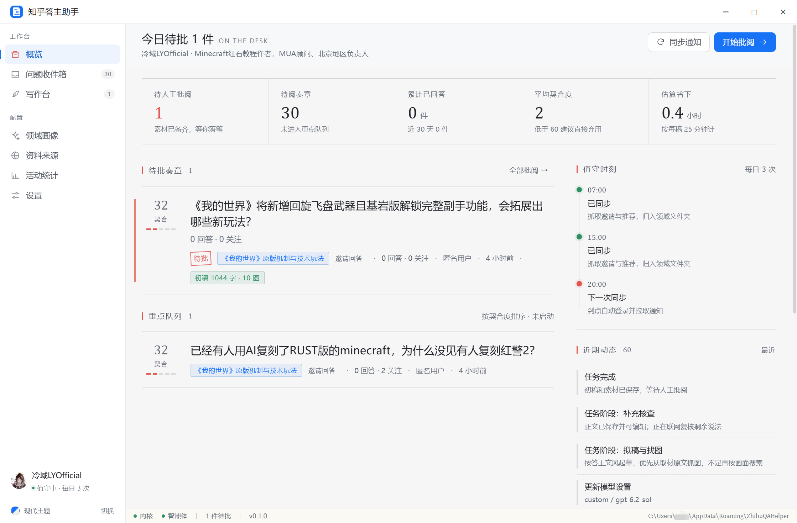
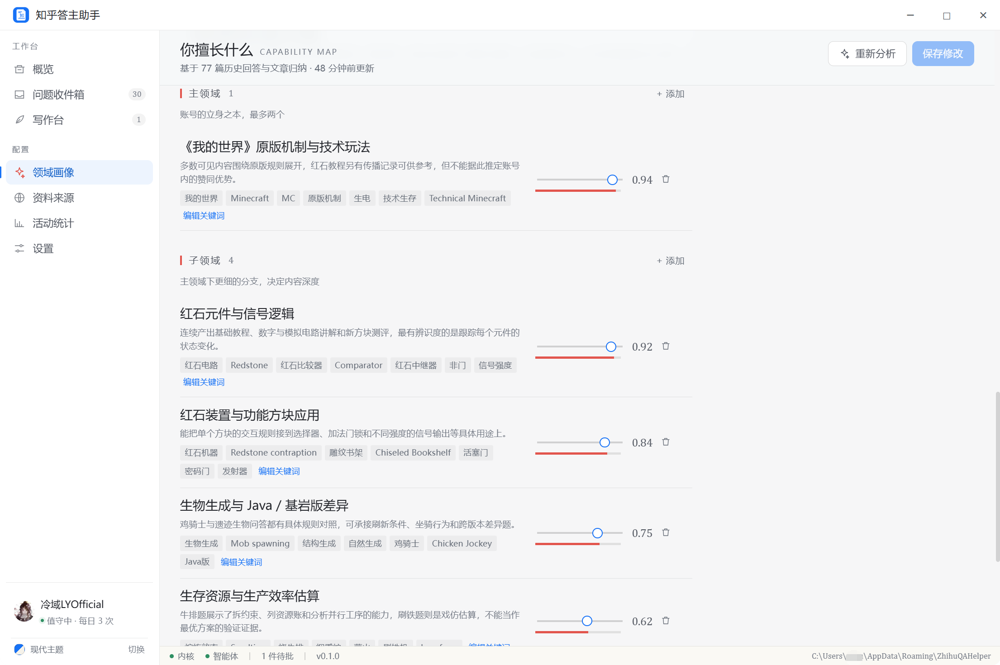
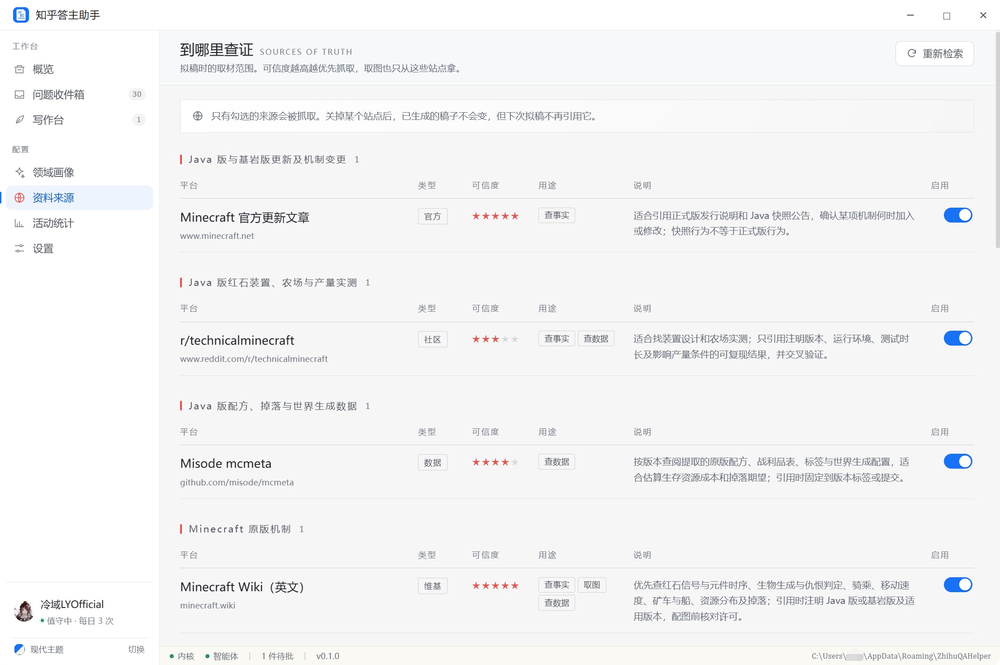

<p align="center">
  
</p>

<h1 align="center">知乎答主助手</h1>

<p align="center">
  <strong>擅长的问题先答，引用和配图都能回到原文。</strong><br />
  给知乎长文答主的 Windows 桌面工作台
</p>

<p align="center">
  <a href="#快速开始"></a>
  <a href="LICENSE"></a>
</p>

<p align="center">
  <a href="#功能实拍">功能实拍</a> ·
  <a href="#快速开始"><strong>快速开始</strong></a> ·
  <a href="#本地开发">本地开发</a> ·
  <a href="https://github.com/LYOfficial/Zhihu-QA-Helper/issues">问题反馈</a>
</p>

<p align="center">
  <a href="img/03.png"></a>
</p>

**写作台 · 先从资料原文找图。** 回答《我的世界》新机制时，可以直接从官方更新文章提取演示图，不够再按具体画面搜索。候选图保留来源链接；「从来源提图」只补充图库，不改已有正文。用图前仍需确认水印和转载许可。

> [!NOTE]
> 助手会同步选题、联网查资料和准备初稿，**不会代你发布知乎回答**。正文与配图由你审阅，在知乎手动发布。

## 功能实拍

从同步邀请到审稿归档，下面用同一组《我的世界》选题展示工作台怎么用。点击图片可查看原尺寸。

### 01 · 案头概览：打开就知道先做什么

待审的稿件、值得关注的问题、下一次同步时间都在首页。不必逐条翻知乎通知，也能看出哪篇已经备好图文、哪条还没开始。应用可在托盘值守，关闭窗口后仍能定时同步邀请和推荐。

[](img/01.png)

### 02 · 问题收件箱：按领域和状态找值得答的题

收进来的问题按契合度排序，也能按领域、处理状态或标题筛选。重点队列优先准备，其他问题仍可手动拟稿。弃用后可以把**问题**恢复到待解答，但不会找回已删除的草稿和配图。

[](img/02.png)

### 03 · 写作画像：参考旧文，不套统一模板

从历史回答和文章提炼语气、人称、句子节奏及不同题材的结构，判定依据也能查看。拟稿按题材参考这些观察和原文片段：教程可以先讲机制，再带读者验证；社区短评不必写成同一套教程结构。

[](img/05.png)

### 04 · 领域权重：你的专长，由你校准

可以把《我的世界》拆成红石逻辑、装置应用、版本差异等细分领域，再补充别名、修改关键词和权重。系统用这些词匹配新问题的标题与标签；修改画像可重算契合度，不会因此启动拟稿。

[](img/06.png)

### 05 · 资料来源：先看它能证明什么

资料页把官方公告、Wiki、数据站和社区分开，标出可信度建议和用途，可逐站启用。查新机制先看官方更新，找玩家实测再看社区。热点取材也会查近期新闻和哔哩哔哩、小黑盒、知乎、贴吧等公开内容；社区帖子可以提供线索，不能当作普遍结论。

[](img/07.png)

### 06 · 证据核查：把确认的事实和没证实的推断分开

正文的引用编号旁有可回查的来源。比如官方说「任一只手都能接盘」，并不等于「副手可以主动投盘」；核查卡片会保留原文、出处、日期和仍需验证的问题。**证据把握是助手的估计，不是实测准确率。**

核查显示当前阶段、已用时间和剩余时间，单轮默认上限 3 分钟，可在设置里调整。复核超时也会保留已保存的正文，可以继续核查或先用 Markdown 编辑；不满意的初稿可清空重拟，并保留候选配图。

[](img/04.png)

### 07 · 活动统计：回看收了什么、答了什么

以近 14 天的收录与回答记录、领域分布和本地存储用量回顾产出：哪些题收得多，哪些真正答完，缓存图片占了多少空间。页面的「节省时间」是估算，不是实际计时。

[](img/08.png)

## 快速开始

1. **安装。** 在 Windows 10/11 上运行简体中文 x64 NSIS 安装包。若 [GitHub Releases](https://github.com/LYOfficial/Zhihu-QA-Helper/releases) 没有可下载的安装包，可[自行构建](#检查与构建)或[从源码运行](#本地开发)。
2. **登录并配置模型。** 完成知乎登录后，在「设置 → 大模型」中选择平台并填写 API Key。登录异常时，可尝试应用内浏览器或默认浏览器 Cookie 兜底方式。
3. **同步并开始批阅。** 首次登录或收件箱为空时会尝试补齐最近 3 天的通知。画像生成后，从案头选一道题，核对资料、编辑草稿，再复制内容到知乎手动发布。发布后可回到工作台标记已回答，归档正文并清理本地配图。

安装版已内置智能体和 Python 运行时，无需另装 Node.js、Rust 或 Python。如果系统提示缺少 WebView2，请先安装 [Microsoft Edge WebView2 Runtime](https://developer.microsoft.com/microsoft-edge/webview2/)。

从旧版升级前，请先在系统托盘退出旧版（关窗不等于退出），再运行新安装包。不要删除用户数据目录：原有登录、配置和草稿仍从原目录读取。

## 技术架构

| 层级 | 技术 | 职责 |
| --- | --- | --- |
| 桌面壳 | Tauri v2 | Windows 窗口、系统托盘与本地集成 |
| 前端 | Next.js、React、TypeScript | 界面、主题、批阅台与进度展示 |
| 本地内核 | Rust、Axum、SQLite | 本地 API、数据存储、知乎同步与任务调度 |
| 智能体 | Python + Pillow | 模型适配、资料整理、图片筛选、领域画像与初稿生成 |

本地服务默认只监听回环地址。知乎 Cookie、草稿、图片和数据库保存在本机；同步、检索和调用所选模型需要联网，拟稿所需的输入会发给所选模型服务。

## 本地开发

### 环境要求

- Windows 10/11
- Node.js 20 或更高版本
- Rust stable 与 MSVC Build Tools
- Python 3.10 或更高版本
- WebView2 Runtime

### 启动项目

```powershell
npm install
python -m pip install -r agents/requirements.txt

# 桌面开发模式：Next 热更新 + Rust 内核 + Tauri 窗口
npm run dev

# 只调前端界面
npm run dev:web

# 分别启动 Rust 内核或 Python 智能体
npm run dev:core
npm run dev:agent
```

模型清单从 `models.dev` 同步，网络不可用时会使用内置清单。设置页可查看模型的上下文与单次输出上限，拟稿会据此分配资料与正文的长度预算。初稿的去套话处理借鉴了 [no-ai-slop-zh](https://github.com/shenxianpeng/no-ai-slop-zh) 的最小编辑思路，改表达时保留事实和引用。

## 检查与构建

```powershell
# 前端类型检查（会先生成 Next 构建类型）
npm run typecheck

# 前端生产导出
npm run build:web

# Rust 工作区测试
cargo test --workspace

# 生成 release 内核和桌面壳
npm run build
```

<details>
<summary><strong>生成便携版</strong></summary>

便携版不需要安装器，把桌面壳和内核放在同一目录即可：

```powershell
npm run build
New-Item -ItemType Directory -Force dist\portable | Out-Null
Copy-Item target\release\zhihu-qa-helper.exe, target\release\zhihu-qa-core.exe dist\portable\ -Force
Copy-Item agents dist\portable\agents -Recurse -Force
New-Item -ItemType Directory -Force dist\portable\apps\web | Out-Null
Copy-Item apps\web\.build dist\portable\apps\web\.build -Recurse -Force
Compress-Archive -Path dist\portable\* -DestinationPath dist\zhihu-qa-helper-portable.zip -Force
```

解压后运行 `zhihu-qa-helper.exe`。运行数据会写入用户数据目录，不建议把数据库放进安装包目录。

</details>

<details>
<summary><strong>生成 NSIS 安装包</strong></summary>

```powershell
npm ci
python -m pip install -r agents/requirements-build.txt
npm run build:nsis
```

使用 Windows x64、对应架构的 Node.js/Python 和 MSVC 工具链构建。输出位于 `target\nsis-build\release\bundle\nsis\`，简体中文安装包使用软件图标，页眉和侧栏从品牌资源生成。安装包内含前端、本地内核及图像处理依赖。可用 `ZHIHU_QA_BUILD_PYTHON` 指定构建环境中的 Python 路径。

回归检查：`python -m unittest discover -s agents -v`、`cargo test --locked -p zhihu-qa-core`。
构建后可运行 `python scripts/smoke-test.py`；它使用临时数据库和模拟模型测试断点续跑，不会访问你的知乎账号。选装 Playwright 后，加上 `--screenshots shots/smoke` 可验证界面并输出截图。

</details>

## 数据目录

```text
data/
  zhihu-qa.db       SQLite 数据库
  images/           问题配图缓存
  domains/          已回答正文归档
  logs/             Rust 内核日志
```

## 贡献与反馈

欢迎通过 [Issues](https://github.com/LYOfficial/Zhihu-QA-Helper/issues) 提交问题或功能建议，也欢迎发起 Pull Request。反馈问题时，请附上系统版本、复现步骤和必要日志，并先移除 Cookie、API Key 等敏感信息。

## 注意事项

- `models.dev` 是模型名称目录，不代表当前账号一定拥有对应模型权限；实际调用结果由所选平台 API 决定。
- 知乎接口和风控策略可能变化，登录失败时优先尝试应用内浏览器或 Cookie 兜底方式。
- 界面可在现代蓝和宣纸印章主题之间切换；截图展示的是现代主题。
- 本项目是第三方工具，不代表知乎官方。

## 开源许可

本项目基于 [GNU General Public License v3.0](LICENSE) 开源。
