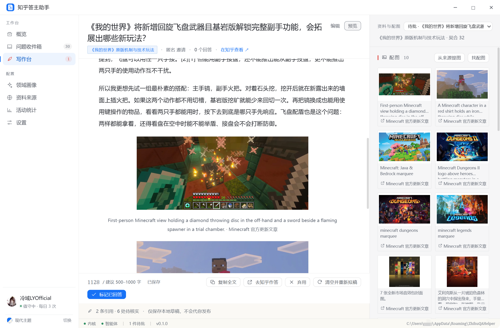
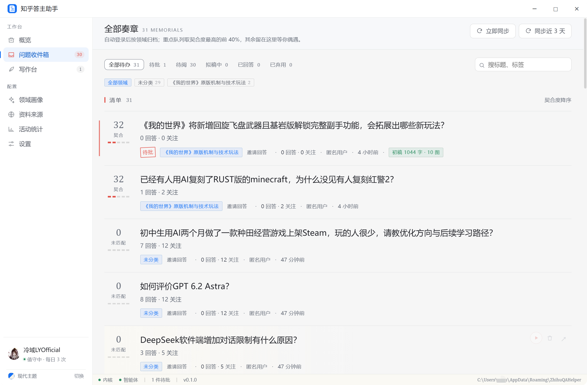
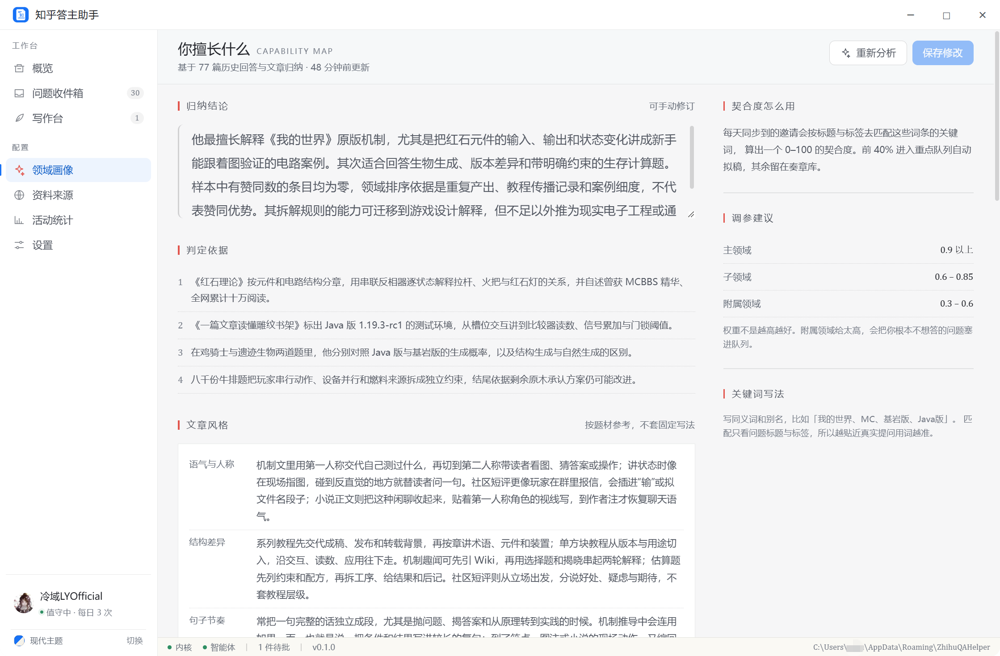
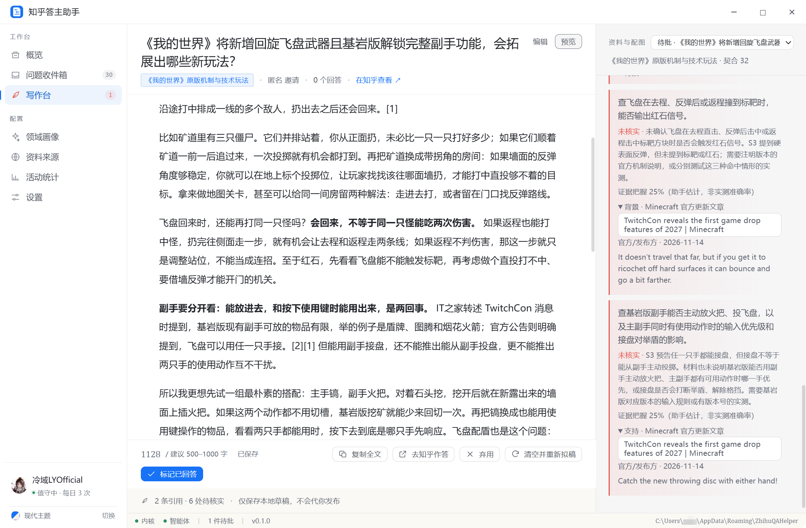
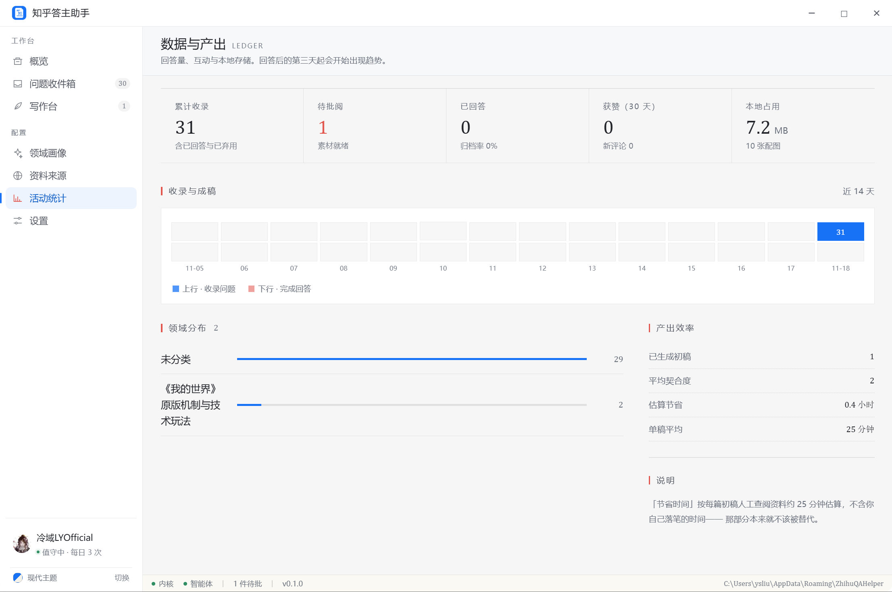

<p align="center">
  
</p>

<h1 align="center">知乎答主助手</h1>

<p align="center">
  在 Windows 上管理知乎选题、资料和草稿
</p>

<p align="center">
  <a href="#快速开始"></a>
  <a href="LICENSE"></a>
</p>

<p align="center">
  <a href="#快速开始"><strong>快速开始</strong></a> ·
  <a href="#使用指南">使用指南</a> ·
  <a href="#本地开发">本地开发</a> ·
  <a href="https://github.com/LYOfficial/Zhihu-QA-Helper/issues">问题反馈</a>
</p>

各位知乎答主，大家好！平时在知乎寻找问题、写回答，你有没有遇到过这些情况？

> - 收到的答题邀请五花八门，翻了半天，和自己擅长的领域沾边的没几道？
> - 正文写到一半，还得到处找合适的配图，找到后又要回头核对出处？
> - 好不容易碰到一道想答的题，打开编辑器，却不知道第一段该怎么写？
> - 写到一处拿不准的细节，直接发怕说错，逐条查证又得花不少时间？
> - 以及……

于是，我们推出了 **知乎答主助手**。它把收集来的题目放进一个工作台，根据你的作答范围和写作风格分析你的人物画像，按你独特的垂直领域筛选问题。选好题后，助手会联网找资料和配图，把出处、待核实的说法和初稿一起放进写作台。你可以围绕初稿进一步补充和修改，完成一篇精美优秀的回答。

我们坚定地认为，**真正好的答案应该是人创作出来的、精准可证实的、讲道理的、优秀的**，所以这只是个帮你搜寻材料和查证真伪的助手，而不是替代你作答发稿的机器，剩下的，笔交给你，键盘交给你，你来补全，你来发布。

欢迎大家体验和使用，如果对本项目感兴趣的话，**欢迎点个 Star**，如果在使用过程出现任何问题，欢迎**通过 [Issues](https://github.com/LYOfficial/Zhihu-QA-Helper/issues) 提交问题或功能建议**，也欢迎**发起 Pull Request**，一起为这个项目添砖加瓦！
[](img/03.png)

## 快速开始

1. 在 Windows 10/11 上运行简体中文 x64 NSIS 安装包。若 [GitHub Releases](https://github.com/LYOfficial/Zhihu-QA-Helper/releases) 暂无安装包，可[自行构建](#检查与构建)或[从源码运行](#本地开发)。
2. 登录知乎后，使用可随时跳过的引导：配置大模型、按需配置知乎 Access Secret、选择拟稿模式、分析画像、同步问题并试写。以后可在「设置」重新打开引导。登录遇到问题时，可尝试应用内浏览器或默认浏览器 Cookie 登录。
3. 打开「问题收件箱」查看邀请和推荐。也可以从「概览」或「问题收件箱」导入分享链接，或在收件箱按画像主动找题。

> 安装版已内置智能体和 Python 运行时，无需另装 Node.js、Rust 或 Python。如果系统提示缺少 WebView2，请先安装 [Microsoft Edge WebView2 Runtime](https://developer.microsoft.com/microsoft-edge/webview2/)。
>
>从旧版升级时，先右键系统托盘图标退出应用，再运行新安装包。保留原有数据目录，新版会从该目录读取登录信息、配置和草稿。

## 使用指南

### 同步通知与挑选问题

首页把待批稿件、重点队列和下次同步时间放在一起。待批稿件已经有正文，可以直接打开审阅；暂时没想好怎么答的题，留在收件箱即可。想集中处理某个方向时，可以按领域和状态筛选，也能搜索标题或标签。

同步时，应用会按账号更新并在本机保留已回答的问题编号，从待办和新一轮选题中排除已知记录；如果历史较多或接口暂时不可用，会保留已有记录并在之后的同步中继续补齐，不会删除原有草稿。同步从新问题中按契合度选择前 40% 的匹配题进入重点队列。

- **全自动模式**：重点队列中的新题自动搜集资料并拟稿；草稿仍需人工审阅和发布。
- **主观模式**：助手只挑题。打开重点队列中的问题，先写一段判断、理由或解题方向，再点「生成初稿」。思路在本机单独保存，拟稿失败也不会丢失。
- **导入问题**：可粘贴最多 10 条链接或知乎复制的整段分享文本。问题链接、问题下的回答链接和独立回答短链按原问题去重，成功后置顶；专栏文章不属于问题，会逐条提示。
- **主动找题**：根据画像搜索知乎内容，结合发问时间、回答与关注量和领域契合度挑题。主动找到、手动导入或自行选择的待阅题不会自动拟稿，打开后可以带着思路生成初稿，也可以留空直接生成。

平时想让应用自己收题，可以在「设置 → 值守与拟稿 → 调整偏好」安排同步时间，并开启「到点自动同步」和「关闭窗口时最小化到托盘」。关窗后仍会按时同步，完全退出应用才会停止值守。

[](img/01.png)

[](img/02.png)

### 调整领域画像与写作风格

「领域画像」从历史回答和文章里归纳主领域、子领域及相关方向。每项可以补关键词和别名、调权重。应用用这些词匹配问题标题与标签；分数高表示更贴近当前设置。改完画像会重新给待阅问题归类和评分，保存这一步不会启动拟稿。如果新题总被分到同一类，可以先检查关键词是否过宽，再调权重。

画像里也有文章风格和对应的作品依据。你可以手动填写具体编辑偏好，例如「讲操作步骤时先写适用版本」。初稿根据题目、查证资料和你的答题思路写成，之后按本题需要参考你设置的组织和排版偏好，通读整理全文。

[](img/05.png)

[](img/06.png)

### 找资料与核对说法

「资料来源」会按领域整理可查的站点，标注来源类型、可信度建议和用途。可以启用常用站点，也可以点「重新检索」补充来源；关掉某个站点会影响后续拟稿，已有草稿和引用会保留。

[](img/07.png)

拟稿时，助手会按问题拆出几条检索词，查发布方原文、专业资料、媒体报道和公开讨论。热点问题会优先找近期材料。需要确认发布时间或适用范围时，先看发布方原文；想了解使用体验或争议，可以参考媒体采访及哔哩哔哩、小黑盒、知乎、贴吧等平台的个案。遇到多家媒体引用同一份通告，可以先回到通告核对原话，再找独立报道补充背景。

在写作台里，正文用编号关联引用；核查卡片会列出待查说法和找到的原文。审稿时可以点回出处，核对日期、对象和上下文，再看原文只能提供背景，还是足以支撑那句话。证据不足的说法会标为待核实，卡片上的「证据把握」是助手对当前材料的估计。发布前可以补查、写明适用条件，或删掉暂时找不到依据的判断。

拟稿前的查证和正文保存后的复核分开计时。每轮默认最多 3 分钟，可在设置里调为 30 至 180 秒。进行中能看到阶段、已用时间和剩余时间；补查超时会保留已保存的正文，稍后可以继续上次任务。

[](img/04.png)

### 给草稿选配图

助手先从已找到的资料原文抽取图片，例如公告中的示意图、文档中的操作截图或报道中的现场照片。数量不足时，再把需要的画面拆成短关键词去搜。手动点「找配图」时也可以输入想要的画面，比如把一整道产品问题缩成「产品名 设置页 截图」。

已有引用或核查来源时，点「从来源提图」可重新读取这些网页。也能在「找配图」里导入自己的图片，附上来源网址。新图会加入备选图库，正文保持原样。在图库里可以打开来源页，把适合的图片插入光标处。发布前请核对授权、署名要求和水印。

[](img/03.png)

### 编辑、发布与归档

写作台可以切换 Markdown 编辑和预览，修改会自动保存。如果保存失败，正文会留在本机恢复区，也可以在当前界面重试。需要换个思路时，待批稿件可以点「清空并重新拟稿」；确认后会清空旧稿，候选配图仍可使用。弃用会删除草稿和配图；事后能从「已弃用」恢复问题，已删除的内容无法恢复。

定稿后点「复制全文」和「去知乎作答」，把文字贴到知乎，按插图提示补齐图片。请在知乎页面核对排版和图源，再手动发布。发完回到写作台点「标记已回答」，应用会归档正文并清理这道题的本地配图。

### 回看一段时间的答题记录

「活动统计」显示近 14 天收录的问题和完成的回答，按领域查看分布，也能看到待批数量和图片缓存用量。可以结合领域分布回头检查收件箱：某个方向的题经常收进来却很少作答，可以在画像里把相关关键词收窄。页面按每篇初稿 25 分钟估算节省的查阅时间，实际用时因题目而异。

[](img/08.png)

## 技术架构

| 层级 | 技术 | 职责 |
| --- | --- | --- |
| 桌面壳 | Tauri v2 | Windows 窗口、系统托盘与本地集成 |
| 前端 | Next.js、React、TypeScript | 界面、主题、批阅台与进度展示 |
| 本地内核 | Rust、Axum、SQLite | 本地 API、数据存储、知乎同步与任务调度 |
| 智能体 | Python + Pillow | 模型适配、资料整理、图片筛选、领域画像与初稿生成 |

本地服务默认只监听回环地址。知乎 Cookie、草稿、图片和数据库保存在本机；同步、检索和调用所选模型需要联网，拟稿所需的输入会发给所选模型服务。

## 本地开发

### 环境要求

- Windows 10/11
- Node.js 20 或更高版本
- Rust stable 与 MSVC Build Tools
- Python 3.10 或更高版本
- WebView2 Runtime

### 启动项目

```powershell
npm install
python -m pip install -r agents/requirements.txt

# 桌面开发模式：Next 热更新 + Rust 内核 + Tauri 窗口
npm run dev

# 只调前端界面
npm run dev:web

# 分别启动 Rust 内核或 Python 智能体
npm run dev:core
npm run dev:agent
```

模型清单从 `models.dev` 同步，离线时可查看内置清单。拟稿按所选模型的容量安排资料和正文篇幅。全文编辑可以重排段落、合并重复解释，再检查出处、数字和代码等细节。编辑失败时，写作台会保留第一版初稿并显示提示。流程参考了 [Self-Refine](https://github.com/madaan/self-refine)、[Humanizer-zh](https://github.com/op7418/Humanizer-zh) 和 [no-ai-slop-zh](https://github.com/shenxianpeng/no-ai-slop-zh)。

## 检查与构建

```powershell
# 前端类型检查（会先生成 Next 构建类型）
npm run typecheck

# 前端生产导出
npm run build:web

# Rust 工作区测试
cargo test --workspace

# 生成 release 内核和桌面壳
npm run build
```

<details>
<summary><strong>生成便携版</strong></summary>

便携版不需要安装器，把桌面壳和内核放在同一目录即可：

```powershell
npm run build
New-Item -ItemType Directory -Force dist\portable | Out-Null
Copy-Item target\release\zhihu-qa-helper.exe, target\release\zhihu-qa-core.exe dist\portable\ -Force
Copy-Item agents dist\portable\agents -Recurse -Force
New-Item -ItemType Directory -Force dist\portable\apps\web | Out-Null
Copy-Item apps\web\.build dist\portable\apps\web\.build -Recurse -Force
Compress-Archive -Path dist\portable\* -DestinationPath dist\zhihu-qa-helper-portable.zip -Force
```

解压后运行 `zhihu-qa-helper.exe`。运行数据会写入用户数据目录，不建议把数据库放进安装包目录。

</details>

<details>
<summary><strong>生成 NSIS 安装包</strong></summary>

```powershell
npm ci
python -m pip install -r agents/requirements-build.txt
npm run build:nsis
```

使用 Windows x64、对应架构的 Node.js/Python 和 MSVC 工具链构建。输出位于 `target\nsis-build\release\bundle\nsis\`，简体中文安装包使用软件图标，页眉和侧栏从品牌资源生成。安装包内含前端、本地内核及图像处理依赖。可用 `ZHIHU_QA_BUILD_PYTHON` 指定构建环境中的 Python 路径。

回归检查：`python -m unittest discover -s agents -v`、`cargo test --locked -p zhihu-qa-core`。
构建后可运行 `python scripts/smoke-test.py`；它使用临时数据库和模拟模型测试断点续跑，不会访问你的知乎账号。选装 Playwright 后，加上 `--screenshots shots/smoke` 可验证界面并输出截图。

</details>

## 官网与版本发布

- **GitHub Pages**：在仓库「Settings → Pages」中选择「Deploy from a branch」，分支选 `main`，目录选 `/docs`。入口为 `docs/index.html`，样式、图标和截图都在发布目录内，不需要额外构建。
- **Release 草稿**：准备新版本时，同步修改 npm 工作区、Tauri 配置和 Rust 工作区的版本及锁文件。将这些改动提交后，在对应提交上打 `vX.Y.Z` 标签并推送。工作流会从标签指向的提交构建 x64 NSIS `setup.exe`，把安装包和 `SHA256SUMS.txt` 加到 Release 草稿，待手动发布。
- **发布说明**：在打标签前，可将该版本文案保存为 `release-notes/vX.Y.Z.md`。没有对应文件时，GitHub 会生成更新日志。[查看 v0.1.0 发布说明](release-notes/v0.1.0.md)。

## 数据目录

开发时默认使用仓库下的 `data` 目录；安装版使用 `%APPDATA%\ZhihuQAHelper`。主要内容如下：

```text
  zhihu-qa.db       SQLite 数据库
  images/           问题配图缓存
  domains/          已回答正文归档
  logs/             Rust 内核日志
```

## 贡献与反馈

欢迎通过 [Issues](https://github.com/LYOfficial/Zhihu-QA-Helper/issues) 提交问题或功能建议，也欢迎发起 Pull Request。反馈问题时，请附上系统版本、复现步骤和必要日志，并先移除 Cookie、API Key 等敏感信息。

## 注意事项

- 模型出现在清单里时，仍需用「测试连接」确认当前 API Key 可以调用它。
- 知乎接口和风控策略可能变化，登录失败时优先尝试应用内浏览器或 Cookie 兜底方式。
- 界面可在现代蓝和宣纸印章主题之间切换；截图展示的是现代主题。
- 本项目由第三方开发，与知乎官方无关。

## 开源许可

本项目基于 [GNU General Public License v3.0](LICENSE) 开源。

## 参考

- [zly2006/zhurl](https://github.com/zly2006/zhurl)
- [知乎开放平台文档](https://developer.zhihu.com/docs)
